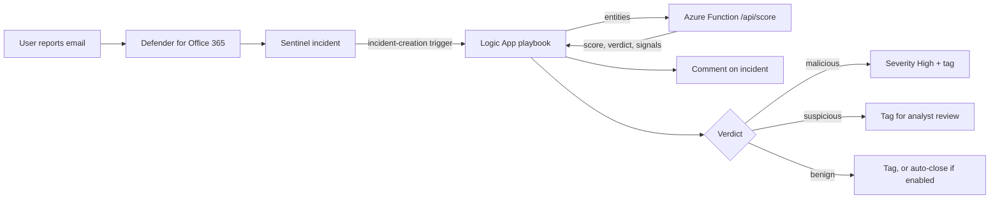

# Sentinel Phishing-Triage Playbook

> A Microsoft Sentinel playbook that scores user-reported phishing incidents, explains *why* in an incident comment, and routes them — escalate, send to review, or close as benign — so analysts spend their time on the emails that matter.


## Problem
User-reported phishing is one of the highest-volume, lowest-signal queues in a SOC. Most reports are newsletters, vendor invoices, or internal mail, but every one has to be opened, checked for spoofing, link tricks, and risky attachments, and then documented. Doing that by hand takes several minutes per report and buries the real phish in noise.

## What I built
- **Scoring engine (Python)**: 15 explainable signals across authentication (SPF/DKIM/DMARC), sender identity (display-name spoofing, lookalike domains, reply-to mismatch), links (raw-IP URLs, shorteners, link text that points somewhere else), attachments (HTML smuggling, ISO/LNK, macro-enabled Office), and content (credential lures, urgency). Each signal has a visible weight, and the output lists every signal that fired.
- **Azure Function** that exposes the scorer over HTTP and accepts Sentinel incident entities directly.
- **Logic App playbook (ARM template)** triggered on incident creation. It calls the scorer, posts the verdict as an incident comment, then:
  - `malicious` (score ≥ 60): raises severity to High and tags `phish-triage:malicious`
  - `suspicious` (30–59): tags `phish-triage:review`
  - `benign` (< 30): tags `phish-triage:likely-benign`, or closes the incident as Benign Positive if `AutoCloseBenign=true`
  - Scoring failure: tags `phish-triage:scoring-failed` so nothing silently drops
- **Follow-up hunting query (KQL)**: finds who else received mail from the same sender and whether anyone clicked.
- **CI**: GitHub Actions runs the unit tests and the evaluation on every push.

## Architecture



## Results (synthetic data)
I ran the scorer against 200 synthetic, labeled reports (78 phish, 122 benign) generated by `sample/generate_samples.py` (seed 7):

| Actual \ Verdict | malicious | suspicious | benign |
|---|---|---|---|
| **phish** | 73 | 4 | 1 |
| **benign** | 0 | 0 | 122 |

- **62% of the queue** would be cleared as likely benign without an analyst opening it.
- **0 benign emails** escalated as malicious.
- **1 phish missed**: an "invoice overdue" email whose only link was a URL shortener and whose authentication passed. That's a real gap. Shortened links need to be expanded and checked against threat intel before scoring, which the `known_bad_urls` hook is designed for (see *What's next*).

These numbers are a **sanity check, not a real-world accuracy claim**. The test set was built from the same kinds of patterns the signals look for. Real reported mail is messier, and the thresholds should be tuned on real reports with `AutoCloseBenign` left off.

## How to run it

### 1. Run the scorer locally (no Azure needed)
```bash
git clone https://github.com/sbsmith340/sentinel-phishing-triage.git
cd sentinel-phishing-triage
pip install pytest
pytest -q tests                                  # 10 tests
python sample/generate_samples.py --count 200 --seed 7
python src/evaluate.py sample/reported_emails.jsonl
```

### 2. Deploy to a lab tenant
**Prerequisites:** an Azure subscription with a Log Analytics workspace that has Microsoft Sentinel enabled, the Microsoft Defender XDR connector (so reported-phish incidents land in Sentinel), Azure Functions Core Tools v4, and Azure CLI. Use a lab or trial tenant, not production.

**a) Deploy the scoring Function**
```bash
# The Function needs the triage package next to it
cp -r src/triage src/function_app/
cd src/function_app
az functionapp create -g <rg> -n <func-name> --storage-account <storage> \
  --consumption-plan-location eastus --runtime python --runtime-version 3.11 \
  --functions-version 4 --os-type Linux
az functionapp config appsettings set -g <rg> -n <func-name> --settings PROTECTED_DOMAINS=contoso.com
func azure functionapp publish <func-name>
# Copy the function URL including ?code=... :
az functionapp function show -g <rg> -n <func-name> --function-name score --query invokeUrlTemplate -o tsv
az functionapp function keys list -g <rg> -n <func-name> --function-name score
```

**b) Deploy the playbook**

[](https://portal.azure.com/#create/Microsoft.Template/uri/https%3A%2F%2Fraw.githubusercontent.com%2Fsbsmith340%2Fsentinel-phishing-triage%2Fmain%2Fsrc%2Fplaybook%2Fazuredeploy.json)

Or use the CLI:
```bash
az deployment group create -g <sentinel-rg> \
  --template-file src/playbook/azuredeploy.json \
  --parameters ScoringFunctionUrl='https://<func-name>.azurewebsites.net/api/score?code=<key>' \
               ProtectedDomains='contoso.com'
```

**c) Grant the playbook access to Sentinel.** Its managed identity needs **Microsoft Sentinel Responder** on the workspace's resource group:
```bash
PID=$(az deployment group show -g <sentinel-rg> -n azuredeploy --query properties.outputs.playbookPrincipalId.value -o tsv)
az role assignment create --assignee-object-id $PID --assignee-principal-type ServicePrincipal \
  --role "Microsoft Sentinel Responder" --scope /subscriptions/<sub-id>/resourceGroups/<sentinel-rg>
```

**d) Attach it with an automation rule.** In Sentinel, go to **Automation → Create → Automation rule**. Set the trigger to *When incident is created* and the condition to *Incident title contains "Email reported by user"* (or your phish alert's title). Set the action to *Run playbook → Phishing-Triage-Playbook*. Sentinel also needs permission to run playbooks in that resource group (**Settings → Playbook permissions**).

**e) Test it** by reporting a test email from a lab mailbox. The incident should get a "Automated phishing triage" comment within a minute or two.

## Framework mapping
| Control / technique | How this addresses it |
|---|---|
| MITRE ATT&CK **T1566.001 / .002** (Spearphishing Attachment / Link) | Attachment-type and link-deception signals |
| MITRE ATT&CK **T1656** (Impersonation) | Display-name spoof, lookalike domain, reply-to mismatch |
| MITRE ATT&CK **T1027.006** (HTML Smuggling) | `.html` / `.svg` attachment detection |
| NIST CSF 2.0 **DE.AE** (Adverse Event Analysis) | Consistent, documented scoring of every report |
| NIST CSF 2.0 **RS.MA / RS.AN** (Incident Management / Analysis) | Automatic triage, severity routing, comment trail |

## Risk view (CIA)
| | Confidentiality | Integrity | Availability | Likelihood | Impact | Risk |
|---|---|---|---|---|---|---|
| **Credential phish reaches users, triaged by hand** | High | Moderate | Low | High | High | **High** |
| **With this playbook** (escalation in minutes, consistent triage) | High | Moderate | Low | Moderate | Moderate | **Moderate** |

**Residual risk:** a phish that passes authentication and hides behind a clean-looking link (see the miss above) can still be scored benign. That's why auto-close ships **off** by default and benign incidents are tagged rather than closed until thresholds are tuned.

**Risks the playbook itself introduces, and the controls for each:**
- The Function key sits in a playbook parameter. It's marked `securestring` and the HTTP action uses secure inputs so the key doesn't show in run history. In production it belongs in Key Vault.
- The playbook identity can modify incidents. It's scoped to Sentinel Responder on one resource group, not Contributor.
- The Function logs verdicts and signal names only, never email content.

## Limitations & what's next
- **Expand shortened URLs and check them against threat intel** (VirusTotal/URLScan) before scoring, and feed the results into `known_bad_urls`. This closes the one miss above.
- Replace the naive domain parsing with `tldextract` for correct eTLD+1 handling (e.g. `.co.uk`).
- Pull email body text with the Defender API so the content signals see more than the subject.
- Add remediation for `malicious`: soft-delete the message across mailboxes with the Defender API, and block the sender.
- Tune the weights from real analyst verdicts, and track the false-negative rate before enabling auto-close.

## Repo layout
```
src/triage/            scoring engine (pure Python, no dependencies)
src/function_app/      Azure Function wrapper
src/playbook/          Logic App ARM template
src/evaluate.py        runs the scorer over a labeled set
sample/                synthetic data generator (all domains fictional)
tests/                 unit tests
docs/hunting/          follow-up KQL
.github/workflows/     CI
```

---
All domains, senders, and data in this repo are fictional or from reserved example ranges. Built by [Shawn Smith](https://sbsmith340.github.io).
